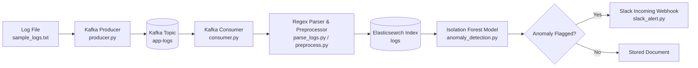

# Kafka Log Analyzer with Real-Time Alerts

A pipeline that streams application logs through Apache Kafka, stores them in Elasticsearch, detects anomalies using an Isolation Forest machine learning model, and delivers Slack notifications.

[](https://www.python.org/)
[](https://kafka.apache.org/)
[](https://www.elastic.co/)
[](https://scikit-learn.org/)
[](https://www.docker.com/)
[](LICENSE)

---

## Table of Contents

- [Overview](#overview)
- [Architecture](#architecture)
- [Demo](#demo)
- [Tech Stack](#tech-stack)
- [Project Structure](#project-structure)
- [Getting Started](#getting-started)
- [Usage](#usage)
- [How Anomaly Detection Works](#how-anomaly-detection-works)
- [Testing and Results](#testing-and-results)
- [Configuration](#configuration)
- [Troubleshooting](#troubleshooting)
- [Limitations](#limitations)
- [Future Improvements](#future-improvements)
- [What I Learned](#what-i-learned)
- [License](#license)

---

## Overview

Modern software systems generate thousands of log lines every hour. Critical failures—such as database connection drops, payment gateway timeouts, and system crashes—frequently get buried in high volumes of routine output, making manual inspection slow and error-prone.

This project implements an automated log collection, storage, and anomaly detection pipeline. Raw logs are streamed through Apache Kafka, parsed and indexed into Elasticsearch, scored using an Isolation Forest machine learning model with TF-IDF keyword extraction, and flagged entries trigger automated alerts to a Slack channel.

---

## Architecture



### Pipeline Flow

1. **Log Generation**: `logs/generate_logs.py` produces structured synthetic log entries containing timestamps, severity levels, and operational messages.
2. **Streaming**: `kafka_client/producer.py` reads the log file line by line and publishes each line to the Kafka topic `app-logs`.
3. **Ingestion & Parsing**: `kafka_client/consumer.py` reads incoming messages from `app-logs`. The parser splits each line via regular expressions into timestamp, severity level, and message body, and normalizes text fields.
4. **Storage**: `storage/elasticsearch_loader.py` indexes parsed log documents into Elasticsearch under the `logs` index.
5. **Model Training**: `ml/train_model.py` queries indexed logs from Elasticsearch, extracts structured and text features, fits an Isolation Forest model, and serializes the model and vectorizer together into `ml/model.pkl`.
6. **Detection & Notification**: `ml/anomaly_detection.py` loads the serialized bundle, scores indexed logs, prints anomalous entries to the console, and triggers an alert via `alerting/slack_alert.py`.

---

## Demo

| Component | Screenshot | Caption |
|---|---|---|
| **Kafka Ingestion** |  | Consumer actively receiving and parsing log messages from Kafka. |
| **Anomaly Detection** |  | Terminal execution of `ml/anomaly_detection.py` flagging anomalous logs. |
| **Slack Notification** |  | Automated alert delivered to the `#log-alerts` Slack channel via webhook. |
| **Automated Testing** |  | Unit tests and labeled evaluation executing in `ml/test_anomaly_detection.py`. |

---

## Tech Stack

| Technology | Version | Purpose |
|---|---|---|
| **Python** | 3.14.3 | Core application logic, text parsing, ML training, and inference |
| **Apache Kafka** | 3.7.0 (Docker) | Distributed message broker for streaming log records |
| **Elasticsearch** | 8.13.0 (Docker) | Search engine and document store for parsed log entries |
| **elasticsearch** | 8.13.0 | Official Python client matching the Elasticsearch server major version |
| **kafka-python** | Latest | Python producer and consumer client library |
| **scikit-learn** | Latest | Unsupervised Isolation Forest model and TF-IDF feature extraction |
| **pandas** | Latest | Structured data frame manipulation and feature preparation |
| **joblib** | Latest | Persistent serialization of trained model and vectorizer bundles |
| **Slack Incoming Webhook** | API | Webhook integration delivering alert notifications to Slack |
| **Docker** | 29.6+ | Containerized local environment management for Kafka and Elasticsearch |
| **Bash** | Latest | Log collection and gzip archive rotation automation |

---

## Project Structure

<details>
<summary>Click to view project directory tree</summary>

```
log-analyzer/
├── logs/
│   ├── generate_logs.py            # Generates 120 synthetic log lines across levels
│   └── sample_logs.txt             # Generated raw log dataset
├── scripts/
│   ├── collect_logs.sh             # Copies log file with a timestamp suffix
│   └── rotate_logs.sh              # Compresses rotated log archives with gzip
├── kafka_client/
│   ├── producer.py                 # Reads sample_logs.txt and publishes to topic app-logs
│   └── consumer.py                 # Consumes messages, parses entries, indexes to ES
├── log_parser/
│   ├── parse_logs.py               # Regex extractor: raw line -> timestamp, level, message
│   └── preprocess.py               # Uppercases level string and trims whitespace
├── storage/
│   └── elasticsearch_loader.py     # Indexes parsed documents into Elasticsearch index 'logs'
├── ml/
│   ├── features.py                 # Shared feature extraction for training and inference
│   ├── train_model.py              # Fetches logs from ES, fits model, saves ml/model.pkl
│   ├── anomaly_detection.py        # Loads model.pkl, scores ES logs, invokes Slack alert
│   ├── test_anomaly_detection.py   # Unit tests, smoke test, and labeled evaluation
│   └── model.pkl                   # Saved bundle containing model and TF-IDF vectorizer
├── alerting/
│   ├── slack_alert.py              # Sends HTTP POST payload to Slack Incoming Webhook
│   └── email_alert.py              # SMTP email alert implementation
├── test_parser.py                  # Standalone verification for regex parser logic
├── test_storage.py                 # Standalone verification for Elasticsearch indexing
├── requirements.txt                # Pinned project dependencies
├── .gitignore                      # Excludes venv, cache files, and model artifacts
└── README.md                       # Project documentation
```
</details>

---

## Getting Started

### Prerequisites

- **Python**: 3.10 or higher (tested on 3.14.3)
- **Docker Desktop**: Running locally
- **Git**

### Installation

1. **Clone the repository:**
   ```bash
   git clone https://github.com/yourusername/log-analyzer.git
   cd log-analyzer
   ```

2. **Create and activate a virtual environment:**
   ```bash
   # Windows (PowerShell)
   python -m venv venv
   venv\Scripts\activate

   # Linux / macOS
   python3 -m venv venv
   source venv/bin/activate
   ```

3. **Install dependencies:**
   ```bash
   pip install -r requirements.txt
   ```

4. **Start infrastructure containers:**
   ```bash
   # Start Elasticsearch
   docker run -d --name elasticsearch -p 9200:9200 \
     -e "discovery.type=single-node" \
     -e "xpack.security.enabled=false" \
     docker.elastic.co/elasticsearch/elasticsearch:8.13.0

   # Start Apache Kafka
   docker run -d --name kafka -p 9092:9092 apache/kafka:3.7.0
   ```

5. **Verify containers are running:**
   ```bash
   docker ps
   ```

---

## Usage

Follow this execution order across terminal sessions:

### Step 1: Start the Kafka Consumer

Open **Terminal 1** (with virtual environment active):

```bash
python kafka_client/consumer.py
```

*Expected output:*
```text
Consumer started, waiting for messages...
```

### Step 2: Stream Logs via the Producer

Open **Terminal 2** (with virtual environment active):

```bash
python kafka_client/producer.py
```

*Expected output:*
```text
Sending 120 log messages to Kafka...
All messages sent successfully!
```

In **Terminal 1**, watch entries arrive and index into Elasticsearch:
```text
[1] INFO - Service started
[2] WARN - Disk usage above 70%
[3] ERROR - Authentication failed
...
```
*Press `Ctrl+C` in Terminal 1 once all lines have been consumed.*

### Step 3: Train the Isolation Forest Model

```bash
python ml/train_model.py
```

*Expected output:*
```text
Fetching logs from Elasticsearch...
Fetched 240 logs.
Valid rows for training: 240 / 240
Feature matrix shape: (240, 17)  (level_code, hour, + 15 tfidf columns)
Training Isolation Forest model...
Model and vectorizer saved to ml/model.pkl
```

### Step 4: Run Verification Tests

```bash
python ml/test_anomaly_detection.py
```

*Expected output:*
```text
Running unit tests...
PASS  test_empty_input
PASS  test_missing_message_field
PASS  test_unknown_level_dropped
PASS  test_malformed_timestamp_dropped
PASS  test_unseen_message_does_not_crash
PASS  test_feature_shape
PASS  test_smoke_unusual_patterns_score_lower_than_normal
...
All tests passed.
```

### Step 5: Run Anomaly Detection and Trigger Alerts

```bash
python ml/anomaly_detection.py
```

*Expected output:*
```text
Fetching logs from Elasticsearch...
Fetched 240 logs.

Detected 24 anomalies out of 240 logs.

Anomalous log entries:
  [ERROR] 2026-08-01 01:10:00 - Server crashed unexpectedly
  [ERROR] 2026-08-01 02:20:00 - Authentication failed
  [ERROR] 2026-08-01 03:10:00 - Database connection failed
  ...
Slack alert sent: Detected 24 anomalies in logs! Check immediately.
```

---

## How Anomaly Detection Works

The anomaly detection component uses an unsupervised **Isolation Forest** algorithm from scikit-learn.

### Feature Representation (17 Features)

Each log entry is transformed into a 17-dimensional vector:
- **Severity Code (1 feature)**: Categorical integer mapping (`DEBUG`: 0, `INFO`: 1, `WARN`: 2, `ERROR`: 3).
- **Hour of Day (1 feature)**: Hour extracted from the timestamp (`0` to `23`) to identify off-peak anomalies.
- **Message Content (15 features)**: TF-IDF vectorizer weights fitted across a fixed 15-word vocabulary:
  `crash`, `failed`, `timeout`, `error`, `authentication`, `connection`, `memory`, `disk`, `slow`, `threshold`, `success`, `completed`, `started`, `login`, `initializ`.

### Model Configuration

- **Algorithm**: `IsolationForest(contamination=0.1, random_state=42)`
- **Contamination Parameter**: Set to `0.1`, configuring the decision boundary to designate approximately the top 10% most isolated data points as anomalies (`-1`).

### Bundled Serialization Architecture

```
ml/features.py (Shared feature pipeline)
       │
       ├──> ml/train_model.py ──> bundle: {'model': model, 'vectorizer': vectorizer}
       │                                              │
       │                                              ▼
       │                                        ml/model.pkl
       │                                              │
       └──> ml/anomaly_detection.py <─────────────────┘
```

TF-IDF assigns sparse column indices based on vocabulary state learned during training. To prevent feature-space mismatch between training and inference, both the trained model and the vectorizer are serialized together in `ml/model.pkl`. Both `train_model.py` and `anomaly_detection.py` import feature extraction from `ml/features.py`, preventing training-serving drift.

---

## Testing and Results

### Running Tests

Execute the unit test and evaluation suite:

```bash
python ml/test_anomaly_detection.py
```

The script runs:
1. **6 Unit Tests**: Edge cases including empty inputs, missing fields, unrecognized severity levels, malformed timestamps, unseen vocabulary, and feature matrix shape.
2. **1 Smoke Test**: Asserts that synthetic unusual entries (e.g., night-time crashes) receive lower mean anomaly scores than normal daytime entries.
3. **Labeled Evaluation**: Evaluates precision, recall, and F1-score on 30 hand-labeled test records (18 normal, 12 anomalous).

### Evaluation Metrics

| Metric | Measured Value | Meaning |
|---|---|---|
| **Precision** | **0.67** | 2 of the 3 flagged records were true anomalies |
| **Recall** | **0.17** | 2 of the 12 actual anomalies were caught |
| **F1-Score** | **0.27** | Harmonic mean of precision and recall |
| **False Positives** | **1** | Normal log incorrectly classified as anomalous |
| **False Negatives** | **10** | Anomalous logs not identified by the model |

### Interpretation of Results

- **Structural Correctness**: The tests verify that preprocessing, feature handling, and serialization work safely without runtime failures.
- **Fixed Contamination Impact**: Because `contamination=0.1`, the model flags roughly 10% of any sample set, which limits recall on test sets containing higher anomaly concentrations.
- **Vocabulary Coverage**: Exact whole-word matching causes inflected words (e.g., `crashed` vs `crash`, `successfully` vs `success`) to produce zero weights, contributing to lower recall.
- **No Baseline Comparison**: These metrics reflect absolute performance on a 30-sample synthetic test set; no historical baseline comparison exists.

---

## Configuration

To prevent exposing credentials, Slack webhook URLs must be provided through environment variables:

### Setting the Webhook URL

**PowerShell (Windows):**
```powershell
$env:SLACK_WEBHOOK_URL = "https://hooks.slack.com/services/YOUR/WEBHOOK/URL"
```

**Bash (Linux/macOS):**
```bash
export SLACK_WEBHOOK_URL="https://hooks.slack.com/services/YOUR/WEBHOOK/URL"
```

`alerting/slack_alert.py` reads `os.environ.get('SLACK_WEBHOOK_URL')`. If the variable is unset, the application prints a warning and skips alert dispatch without interrupting pipeline execution.

---

## Troubleshooting

<details>
<summary>Click to view common issues and fixes</summary>

| Problem | Cause | Solution |
|---|---|---|
| `Unable to bootstrap from localhost:9092` | Kafka Docker container is stopped after system reboot. | Run `docker start elasticsearch kafka` and wait 20–30 seconds before executing clients. |
| `BadRequestError 400 media_type_header_exception` | Installed `elasticsearch` Python client version 9.x against server version 8.13.0. | Pin client version matching the server: `pip install elasticsearch==8.13.0`. |
| `ModuleNotFoundError: No module named 'log_parser'` | Script executed from a subfolder where the project root is not in `sys.path`. | Run all commands from the repository root, or ensure `sys.path.append('.')` is included at the top of the entrypoint. |
| `python -m kafka.consumer` executes internal tool | Local folder named `kafka/` clashed with installed `kafka-python` namespace. | Local client directory is renamed to `kafka_client/` to avoid module shadowing. |
| `WinError 10061` during email alerting | No local SMTP server is running on `localhost:25`. | Expected when running locally without an SMTP host. Email alerts fail safely; Slack alerts remain operational. |
| Duplicate document counts in Elasticsearch | Ingesting the 120 synthetic lines multiple times creates duplicate records. | Elasticsearch assigns unique IDs automatically per POST; clear the index (`DELETE /logs`) if a pristine count is needed. |

</details>

---

## Limitations

- **On-Demand Anomaly Detection**: In the current implementation, log streaming into Elasticsearch is continuous, but anomaly detection is triggered via a batch script rather than inline per incoming Kafka event.
- **Fixed Flag Rate**: The model's `contamination=0.1` threshold forces approximately 10% of any batch to be flagged regardless of whether the true anomaly count is higher or lower.
- **Synthetic Dataset**: Trained and evaluated on 120 generated synthetic log entries rather than live production traffic.
- **Keyword Inflection Sensitivity**: The TF-IDF token pattern performs exact whole-word matching, meaning word variations (`crashed` vs `crash`) do not match the static vocabulary entries.
- **Local SMTP Dependency**: Email alerting requires a configured local mail transfer agent and is not supported out of the box on standard developer workstations.

---

## Future Improvements

- Embed anomaly scoring directly into `kafka_client/consumer.py` for real-time per-event evaluation and alerting.
- Implement word stemming (e.g., Porter Stemmer) or subword tokenization to capture inflected verbs and plurals in log messages.
- Evaluate the pipeline against standard benchmark log datasets (e.g., Loghub, NASA HTTP access logs).
- Add alert deduplication and rate-limiting cooldown windows to manage alert volume during recurring incidents.
- Build containerized integration tests using `docker-compose`.

---

## What I Learned

- Designing end-to-end distributed data pipelines connecting message queues, document indexing, and machine learning components.
- Managing client-server version compatibility across containerized backends (Elasticsearch 8.13.0 and Kafka 3.7.0).
- Building leakage-free ML evaluation pipelines by packaging vectorizers and models into unified serialized bundles.
- Structuring transparent, test-backed machine learning evaluations with objective metrics and honest reporting of limitations.

---

## License

This project is licensed under the MIT License — see the [LICENSE](LICENSE) file for details.
